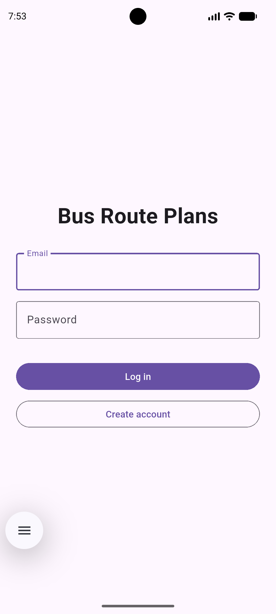
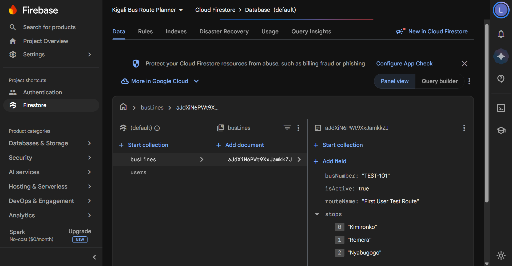
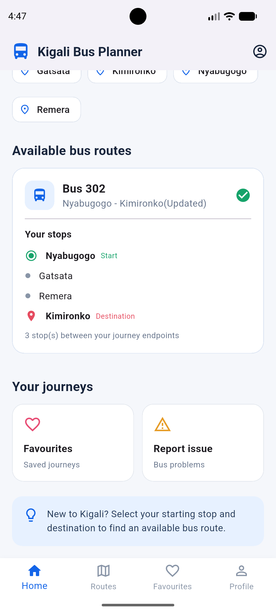
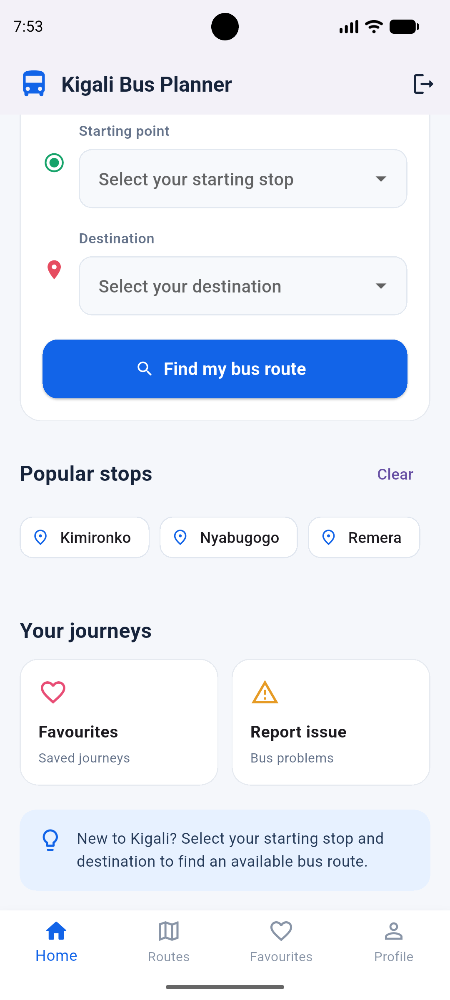

# Kigali Bus Planner

A Flutter application that helps users find bus routes in Kigali. It uses Firebase Authentication to sign users in and Cloud Firestore to store data under each user's unique ID, ensuring private user data is separated between accounts and changes appear live.

## Screenshots

